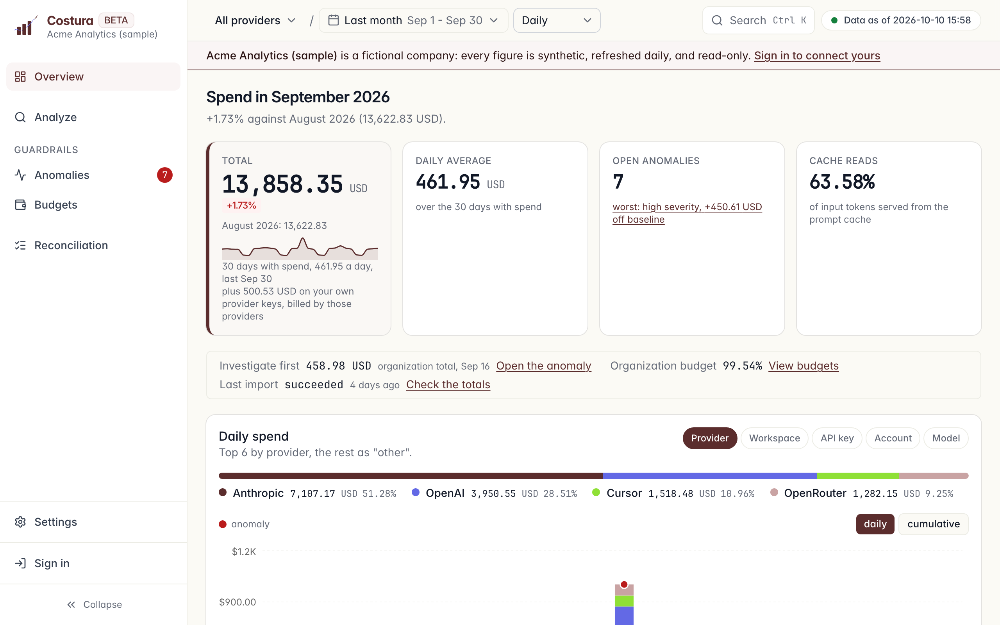

<div align="center">
  
  <h1>Costura</h1>
  <p><strong>Self-hosted AI spend attribution: who spent what, per provider and per person, with totals that tie out to each provider's own report.</strong></p>
  <p>
    <a href="#quickstart">Quickstart</a> -
    <a href="docs/operations/install.md">Install</a> -
    <a href="docs/product/screens.md">Screens</a> -
    <a href="docs/architecture/overview.md">Architecture</a> -
    <a href="CONTRIBUTING.md">Contributing</a>
  </p>
  <p>
    <a href="https://github.com/CosturaAI/costura/actions/workflows/ci.yml"></a>
    <a href="LICENSE"></a>
  </p>
</div>

Costura imports read-only billing data from the AI providers a team uses, stores it as one
daily ledger, attributes each dollar to an API key, a workspace or a person, and checks every
month that the stored total matches what the provider itself reports. It runs on your own
infrastructure with Docker Compose. There is no hosted service, and nothing is sent to the
maintainers.

Costura is in beta. Every `0.x` release is marked as a pre-release, and interfaces, the API
and the configuration can change between minor versions until `1.0`. Each change is listed
in [CHANGELOG.md](CHANGELOG.md).



## Features

- **Read-only connectors** for Anthropic, Claude.ai, OpenAI, Codex, OpenRouter and Cursor,
  plus GitHub Copilot as an experimental connector. Each one uses the provider's admin or
  analytics API and never writes to it.
- **One person across providers.** A person is one e-mail. Seat products (Cursor, Claude.ai,
  Codex) report per user; an API key counts under a person when Anthropic created it for a
  Claude Code session or when a member marks it as that person's key.
- **Reconciliation per provider and per month.** Stored rows against the provider report,
  attribution against the cost, Costura's total against the provider's control total, and
  against the invoice total an owner types in.
- **Anomalies, budgets and signals.** Anomalies name their cause and its share of the
  change. Budgets cover a month, an ISO week or a day for an organization, a workspace, a
  person or a team. Open signals reach the header bell and, when allowed, one signed
  Slack-compatible webhook per organization.
- **Analyze and export.** Spend by model, key, workspace, person or team, with filters,
  comparison and CSV export.
- **Operated like a product.** Provider keys are encrypted at rest, sessions are stored as
  hashes, the API and worker run under a restricted database role, and backups, upgrades and
  monitoring are documented.

Every screen, with what it does: [docs/product/screens.md](docs/product/screens.md).

## Who it is for

A team that wants to see API spend and seat spend per person across providers, keep its
provider admin keys on its own infrastructure, and check each month that the figures add up
to the provider's report and to the invoice.

Costura is not the right tool for per-request cost, traces or prompt logs in real time (use
an LLM gateway or tracer), for blocking spend at a limit (it alerts; the hard cap lives in
each provider's console), or for AI spend next to cloud spend in one FinOps suite.

## Quickstart

Install [mise](https://mise.jdx.dev/getting-started.html) and Docker Compose v2, and
[activate mise](https://mise.jdx.dev/getting-started.html#activate-mise) in your shell so the
pinned `just`, `uv`, `pnpm` and Node.js are on `PATH`. Then:

```
mise install
just doctor
just setup
just dev
```

`just setup` copies `.env.example` to `.env` and installs dependencies. `just dev` starts
PostgreSQL, runs the migrations, seeds the sample organization and serves the API at
`http://127.0.0.1:8000` and the web app at `http://127.0.0.1:3000`. On a local stack,
`/sign-in` accepts any e-mail, and `GET /docs` on the API is the route reference.

Saving a provider key needs `COSTURA_SECRET_KEY`; `just api::secret-generate` prints one for
`.env`. `just doctor` checks the tool versions, the Docker daemon, the ports and that key
without printing it.

The sample organization is a fictional company, Acme Analytics: thirteen months of synthetic
spend across Anthropic, OpenRouter, OpenAI and Cursor, read-only, with no provider credential
stored. The sign-in page offers "Explore the sample organization" without an account.
`just api::demo-status` reports whether the dataset is current and `just api::demo-refresh`
rebuilds it through today.

## Production

> Pre-release: the `v0.1.0` tag and the `ghcr.io/costuraai/costura-*` images are not
> published yet. Until they are, use `just prod::up-local`, which builds the images from
> this checkout, in place of `just prod::up`.

```
just prod::init --email you@example.com
just prod::up
```

`just prod::init` writes `.env` with generated secrets. `just prod::up` starts PostgreSQL, a
one-shot migration, the API, the worker, the scheduler, the web app and a Caddy proxy, one
replica each, from `docker-compose.prod.yml`.

| Topic | Page |
| --- | --- |
| Install, including an external PostgreSQL | [docs/operations/install.md](docs/operations/install.md) |
| Every environment variable | [docs/operations/configuration.md](docs/operations/configuration.md) |
| Upgrade | [docs/operations/upgrade.md](docs/operations/upgrade.md) |
| Backup and restore | [docs/operations/backup-restore.md](docs/operations/backup-restore.md) |
| Monitoring | [docs/operations/monitoring.md](docs/operations/monitoring.md) |
| Troubleshooting and error codes | [docs/operations/troubleshooting.md](docs/operations/troubleshooting.md), [docs/operations/errors.md](docs/operations/errors.md) |
| Webhooks | [docs/operations/webhooks.md](docs/operations/webhooks.md) |
| Provider keys and permissions | [docs/security/provider-keys.md](docs/security/provider-keys.md) |
| Threat model | [docs/security/threat-model.md](docs/security/threat-model.md) |

## How it works

The scheduler queues one sync per organization and provider account each day. The worker
claims it, reads cost, usage and inventory through the read-only client, writes daily lines
to the ledger, then allocates spend, detects anomalies, projects the month and evaluates
budgets. The web app renders on the server and reads the ledger through the API. The
diagram is [docs/architecture/overview.md](docs/architecture/overview.md).

`just api::tieout-report --org <slug>` prints the reconciliation verdicts as percentages,
with no amount, key, workspace or e-mail, so the output can go into a public issue.

## Using with AI

- `npx skills add CosturaAI/costura` installs the agent skill in
  [skills/costura/SKILL.md](skills/costura/SKILL.md): install, the `just` recipes, the API
  query model and the tie-out report, in the [Agent Skills](https://agentskills.io) format.
- On a running `just dev`, the API serves `http://localhost:8000/openapi.json` and the route
  reference at `http://localhost:8000/docs`.
- [llms.txt](llms.txt) lists every documentation page with one line each.
- [AGENTS.md](AGENTS.md) is the entry point for an agent working on the code.

## Contributing

```
just check
just coverage-core
just smoke
```

`just check` is workflow lint, lint, types, generated API types and the secret scan.
`just coverage-core` starts PostgreSQL and runs the API and web suites with the coverage
floors CI enforces. `just smoke` boots the whole stack once and checks it over HTTP. The workflow, the commit format and the review expectations are in
[CONTRIBUTING.md](CONTRIBUTING.md).

## Support and security

- A bug: a [bug issue](https://github.com/CosturaAI/costura/issues/new?template=bug.yml)
  with `COSTURA_VERSION`, what is affected and the steps to reproduce.
- A question: [GitHub Discussions](https://github.com/CosturaAI/costura/discussions).
- What support means for a self-hosted project: [SUPPORT.md](SUPPORT.md).
- A vulnerability: [SECURITY.md](SECURITY.md), never a public issue.
- Costura sends nothing to its maintainers. The only outbound calls are the read-only
  requests to the providers you connect and, when configured, Google sign-in
  ([SUPPORT.md](SUPPORT.md#language-and-telemetry)).

## License

Apache-2.0 ([LICENSE](LICENSE), [NOTICE](NOTICE)). Governance, trademark and conduct:
[GOVERNANCE.md](GOVERNANCE.md), [TRADEMARK.md](TRADEMARK.md),
[CODE_OF_CONDUCT.md](CODE_OF_CONDUCT.md).
