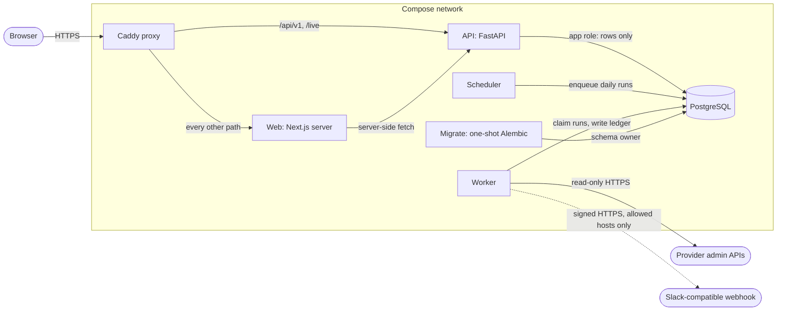

# Architecture overview

One host, one replica of each service, from `docker-compose.prod.yml`.

- **Proxy** (Caddy) terminates TLS. It forwards `/api/v1` and `/live` to the API and every
  other path to the web app. `/ready`, `/health` and `/metrics` answer 404 from outside.
- **Web** renders every page on the server and calls the API with the user's session; the
  browser never holds an API token.
- **API** serves reads and writes for signed-in members. Its port is not published.
- **Scheduler** enqueues one run per organization and provider account each day. It does
  not call providers.
- **Worker** claims queued runs from PostgreSQL, imports cost, usage and inventory through
  read-only clients, then allocates,
  detects anomalies, projects the month and evaluates budgets. About once a minute it posts
  new signals to each organization's webhook, when `COSTURA_WEBHOOK_HOSTS` allows its host;
  every 15 minutes it records which signals opened and closed.
- **Migrate** runs once per start as the schema owner. The API, worker and scheduler
  connect as a restricted role that cannot change the schema.
- **PostgreSQL** holds the ledger, the queue, encrypted provider keys and webhook URLs, and
  session hashes.

## Data flow of one daily import

1. The scheduler inserts a `scheduler_runs` row per account.
2. The worker claims it, then calls the provider for cost, usage and inventory, storing raw
   pages and normalized daily lines.
3. Allocation splits each day's cost to keys, workspaces and people.
4. Anomaly detection, the month-end projection and budget thresholds run on the allocated
   lines.
5. Pages read the ledger through the API; reconciliation compares it with the provider's
   own totals and with the invoice an owner typed in.

Operator details: [install](../operations/install.md),
[configuration](../operations/configuration.md),
[monitoring](../operations/monitoring.md). Trust boundaries:
[threat model](../security/threat-model.md).
