# Screens

Every screen of the web app, captured from the sample organization (Acme Analytics,
September 2026, every figure synthetic) with `just web::screens` on a running `just dev`
stack. The text under each image states what the screen does in the current code, so a
change to a screen is a change to its section and its image.

The sample organization is read-only, so write controls (budgets, invoice totals, marking
a key, connecting a provider) show their read-only notice here. In an organization with a
key they render as forms.

## Overview

The scope bar at the top holds the provider (`All providers` or one), the time frame and
the interval. Every page reads them. Overview answers "what changed, and what should I do":
the total for the period against the previous one with a sparkline (when the cost syncs
cover only part of the month, both sides stop at the same day, the header says "Data
through <day>", and a drop is not colored as savings) and whether it matches the
provider's own report ("matches provider", "differs from provider by <amount>" or
"provider check pending", linking to Reconciliation), the daily average, the
open anomalies with the worst one's own impact and a link to it, and cache reads. The strip below shows the organization budget
and the last import. "Needs a person" lists the three open signals with the most money:
open anomalies of any date, this month's budget alerts, connected accounts whose import
stopped, and active keys with a governance gap
(no owner, no limit, owner left, idle but active, new). It ignores the time frame.

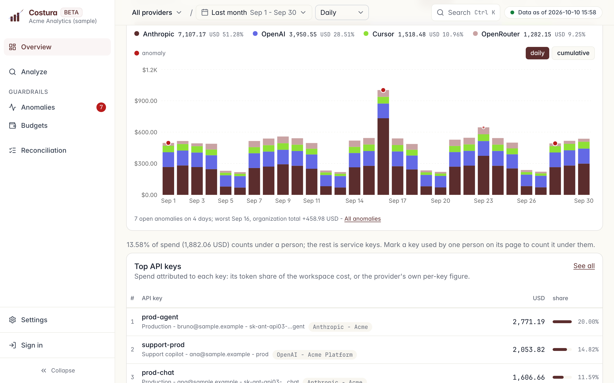

The daily chart groups by provider, workspace, API key, account or model, daily or
cumulative. Red dots mark anomalous days. The share bar above it splits the period by
the chosen dimension.

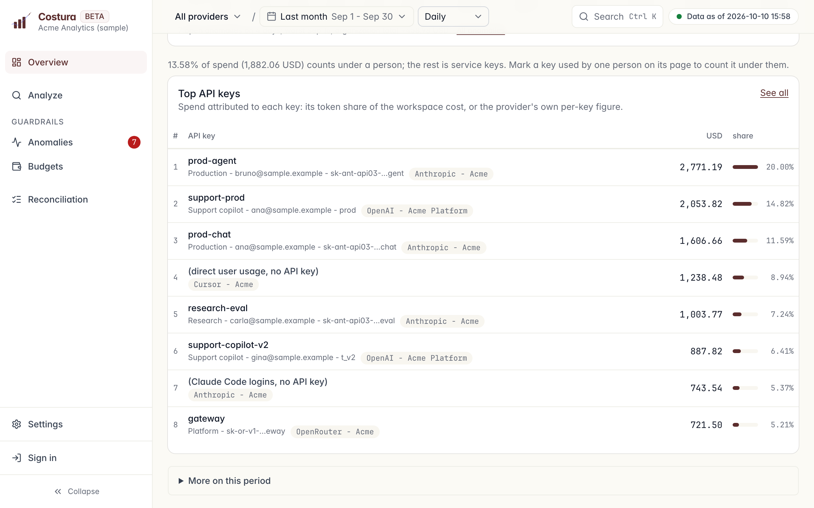

For a calendar month, one line says how much of the spend counts under a person and how
much is service keys, with the instruction to mark a key used by one person on its page.
Top API keys lists each key with its workspace, creator, provider account and share.
`(direct user usage, no API key)` is Cursor; `(Claude Code logins, no API key)` is
Anthropic OAuth usage. More cards sit under "More on this period".

For a calendar month, "Month in review" in the header opens `/review`: the month told in
sentences (where the money went, against the plan, largest moves, anomalies, needs a
person) for the scope and month in the URL. It copies a link that opens the same
organization, downloads the same text as Markdown, and prints without the app chrome.

## Analyze

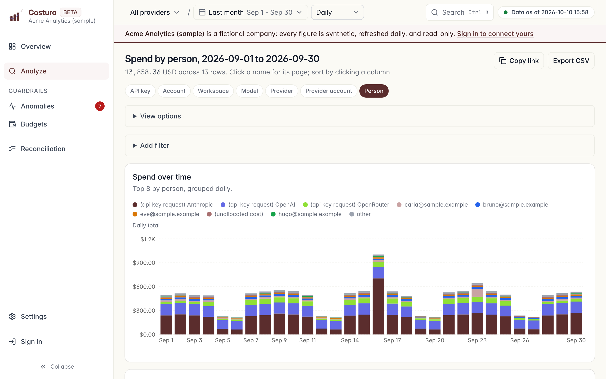

Analyze (`/explore`) groups the period's spend by API key, account, workspace, model,
provider, provider account, person or team, as a chart and a table. Copy link reproduces the
view; Export CSV downloads the table. A person is one e-mail across providers;
`(api key request)` rows are service-key spend, one per provider. A team takes a line by
its key, else its person, else its workspace; the rest is `(no team)`.

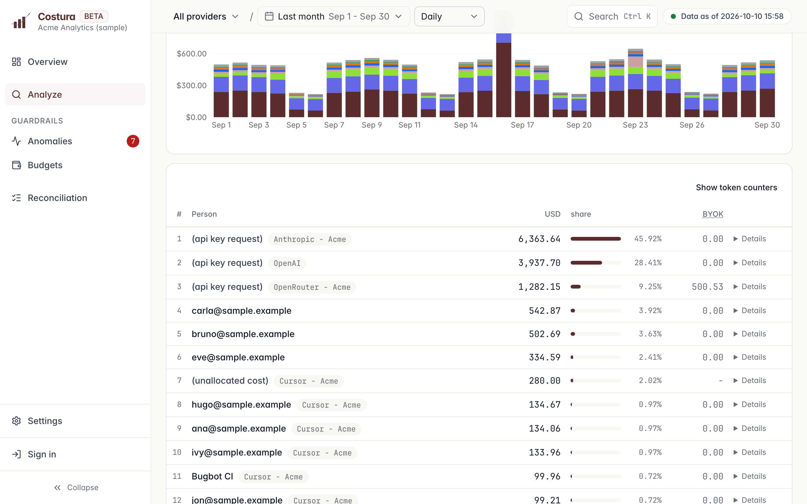

The table carries the amount, the share and, behind "Show token counters", the tokens.
A name opens its page.

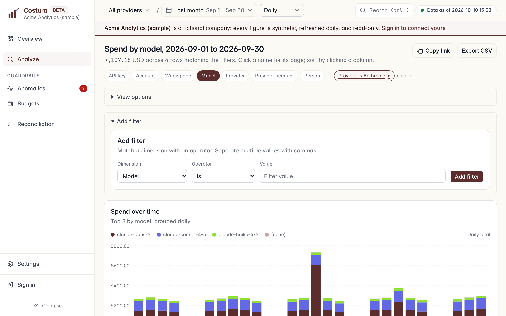

Filters are clauses of dimension, operator (`is`, `is_not`, `one_of`, `not_one_of`,
`contains`, `not_contains`, `exists`, `not_exists`) and value, shown as chips. Row limits,
display, chart axis and a linear projection sit under View options.

## Search and people

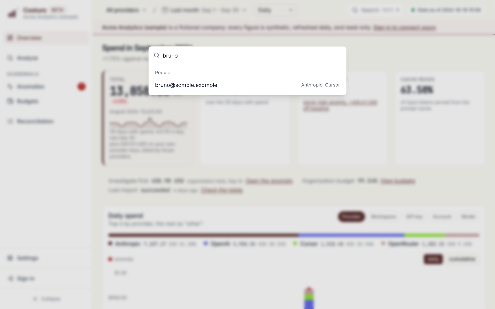

Ctrl+K or Cmd+K finds people, services, API keys and workspaces in the active organization
and provider from two characters. A person result lists the providers the e-mail appears in.

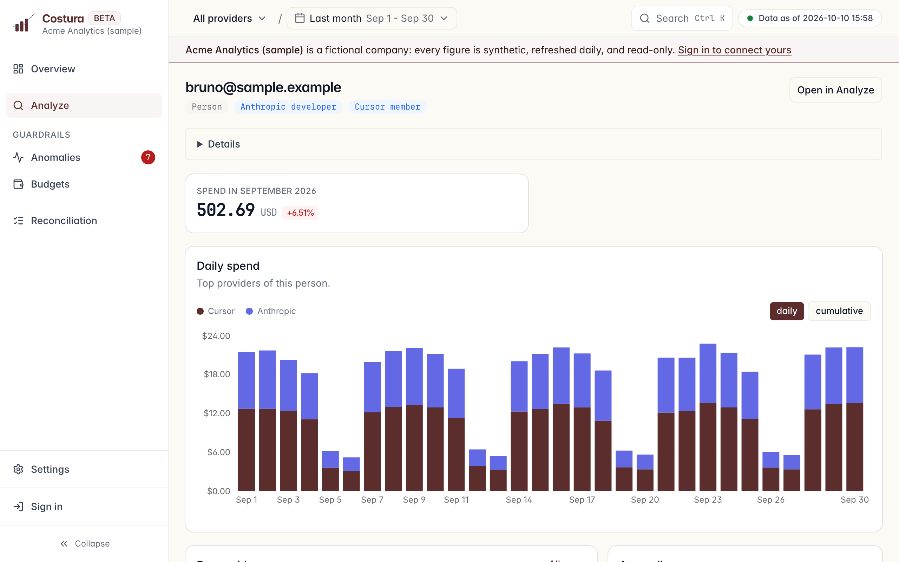

The person page is one e-mail across providers: one badge per provider account with the
role there, the spend in the period against the previous one, and the daily chart by
provider.

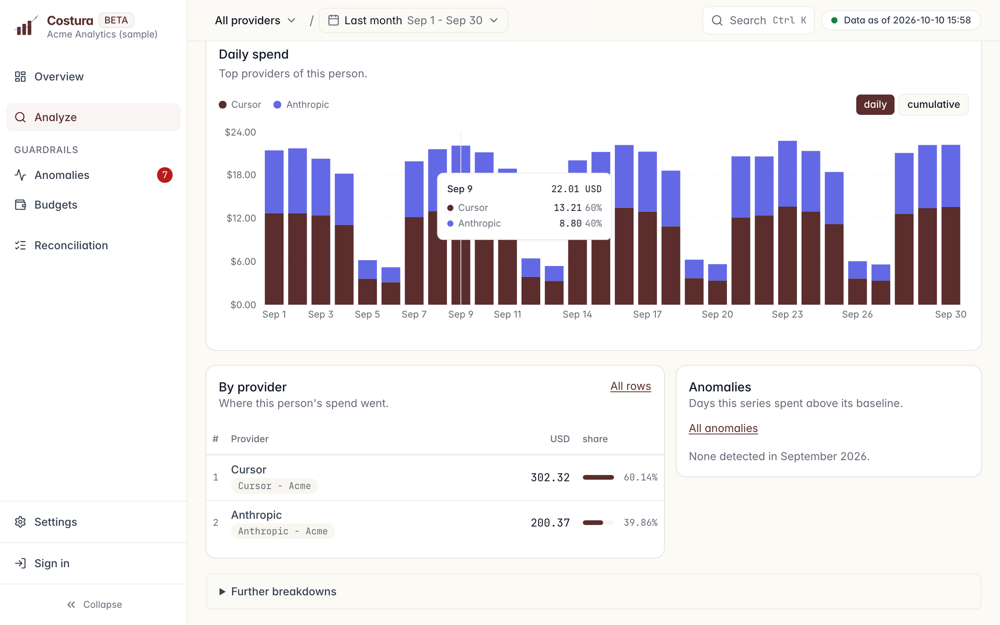

Hovering a day shows each provider's amount and share. By provider is the same split as a
table; Anomalies lists the days this person's series left its baseline.

## API keys and other entities

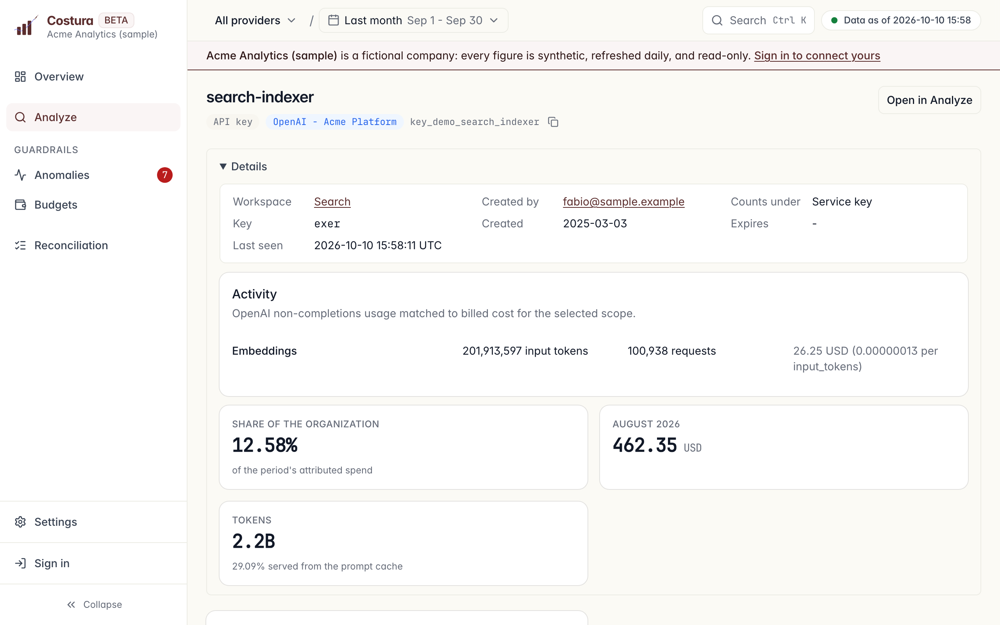

A key page shows its workspace, creator, hint, dates and "Counts under": the e-mail its
spend counts under in the person view, or "Service key". Below the facts, a member marks the
key as one person's own; the sample hides the form. Activity lists non-token
usage families (embeddings, web search) with their billed cost.

The account (`/accounts/{id}`), workspace (`/workspaces/{id}`) and model (`/models/{id}`)
pages share the key page's shape: identity, the spend in the period against the previous
one, the daily chart, one breakdown and the alerts that name the entity; facts, further
breakdowns and the budget sit under Details. Under `all` a row carries its provider badge and
opens its entity under that provider. These pages have no image here; `e2e/pages.ts` opens
them in the accessibility suite.

## Guardrails

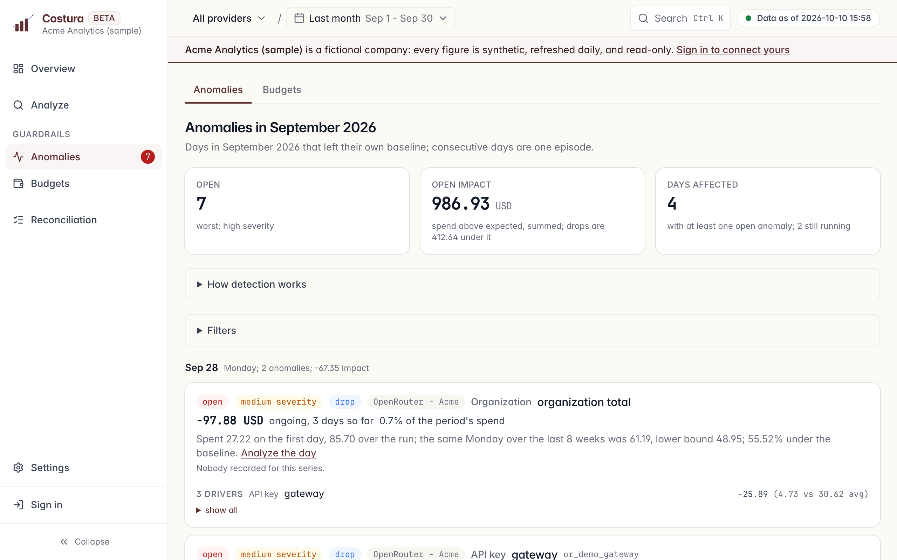

Anomalies are days that left their own baseline, grouped into episodes. The header counts
open anomalies, the spend above expected (drops, money that stopped arriving, are counted
apart) and the days affected. Each row opens with one sentence that names the cause and its
share of the change, then the severity, direction, provider account, series and impact,
with its drivers (each with its share) and a link to the day in Analyze. "How detection works" explains the baseline; Filters narrow by status, severity
and series kind. "Closed in the last 90 days" lists every signal that stopped needing a
person (anomalies, budgets, imports, key gaps) with how long it stayed open; in "Needs a
person" and the bell, a signal whose entity opened before reads "2nd time in 90 days".

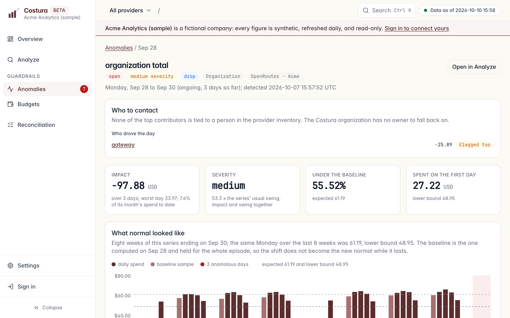

An anomaly page leads with who to contact (the assigned contact, the key's creator, the
workspace admins, then the organization owners), who drove the day, and four figures:
impact, severity, distance from the baseline, and the first day's spend against the bound.

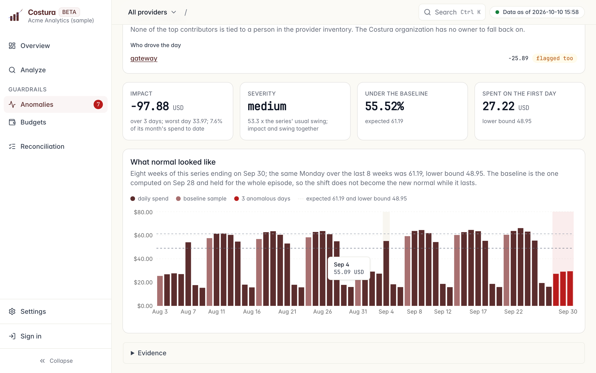

"What normal looked like" draws eight weeks of the series with the baseline sample days,
the anomalous days and the expected value and bound. The baseline is the one computed on
the first day and held for the episode. Supporting tables sit under Evidence.

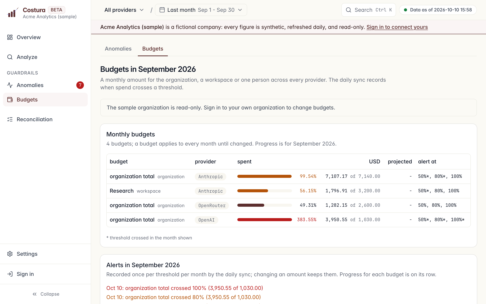

A budget is an amount per month, per ISO week or per UTC day for the
organization total of one provider or of every provider together, a workspace, or one
person or one team across every provider (both are monthly). The row is the
progress bar, the amount spent, the projection while the month runs, and the thresholds;
an asterisk marks a threshold crossed in the month shown. A week or day budget reads the
week or day that holds today, names it next to the amount, and has no projection. Alerts are
recorded once per threshold per month, week or day by the daily sync. Nothing is enforced
at the provider.

## Data health

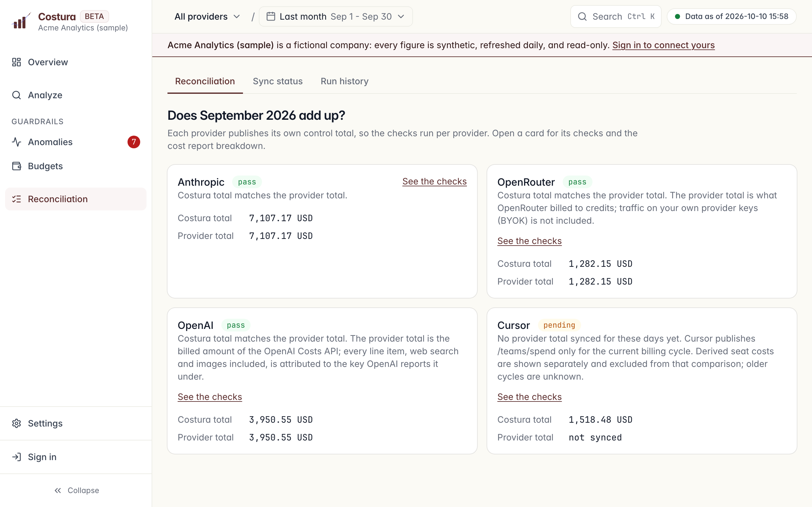

Under `All providers`, Reconciliation shows one card per provider: Costura's total, the
provider's own control total, and the verdict. Cursor publishes its total for the current
billing cycle only, so a closed month is pending.

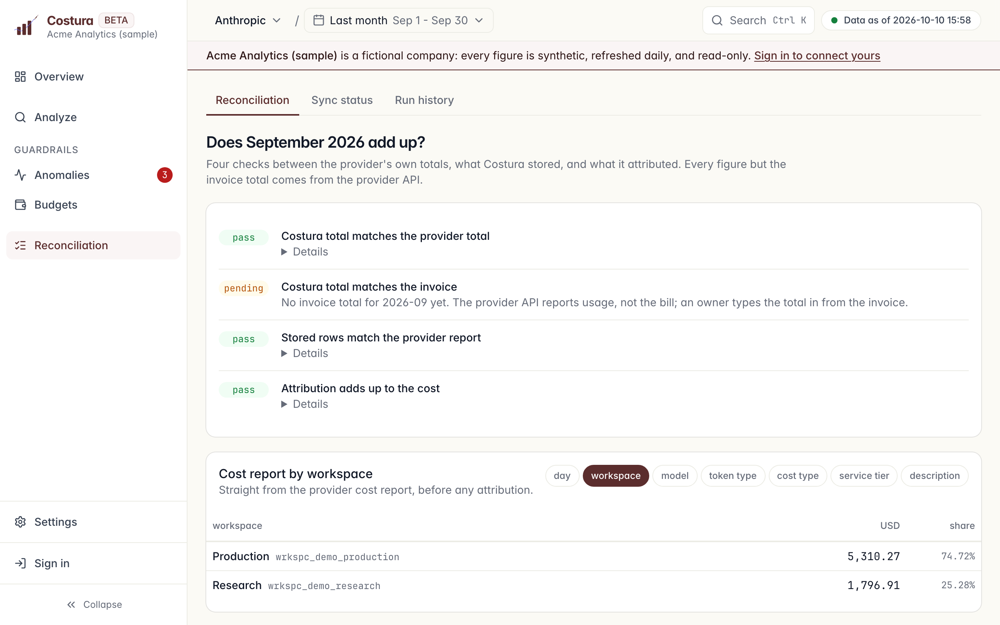

Under one provider, the checks run in full: Costura total against the provider total
(tolerance one cent), Costura total against the invoice total an owner typed in,
stored rows against the provider report, and attribution adding up to the cost.
OpenAI adds the per-key check and activity-family coverage; Codex adds the credit check. A
passing check is one line with its details on demand. The cost report breakdown below
groups the period by day, workspace, model or key.

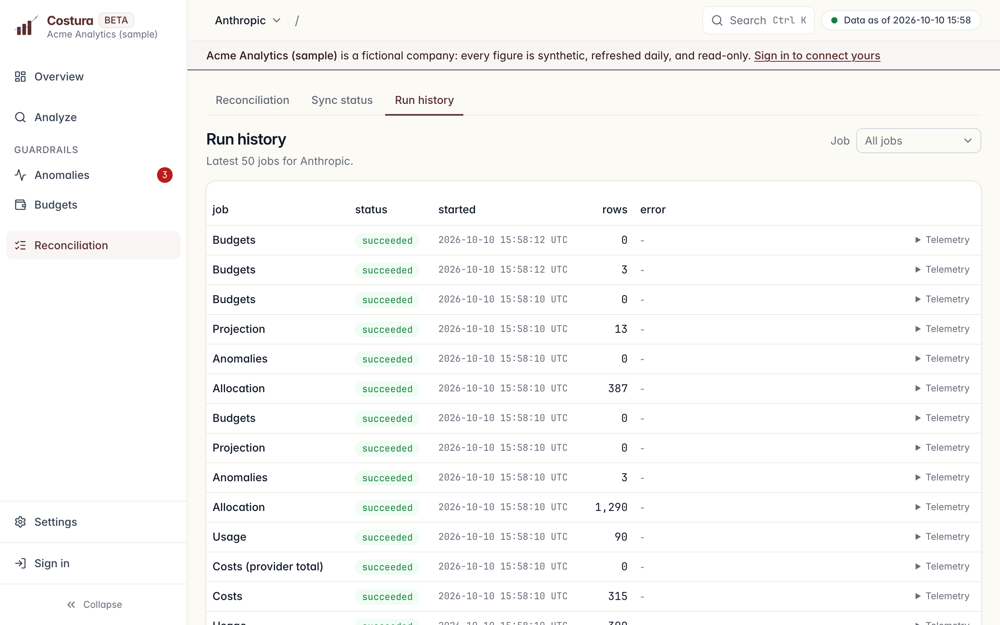

Sync status and Run history are tabs beside Reconciliation. Run history lists the latest 50
jobs of the provider with status, time, rows and error; window, duration, pages and raw
results open under Telemetry. A failed job folds its error under its first words; opening
it shows the full text and a Copy details button that puts job, provider, run id, status,
error text, release and time on the clipboard as Markdown. When a page cannot load, the
error panel names what failed and offers Retry and Copy details; Technical details shows
the Next.js reference and, for an API refusal, the error code listed in
[docs/operations/errors.md](../operations/errors.md).

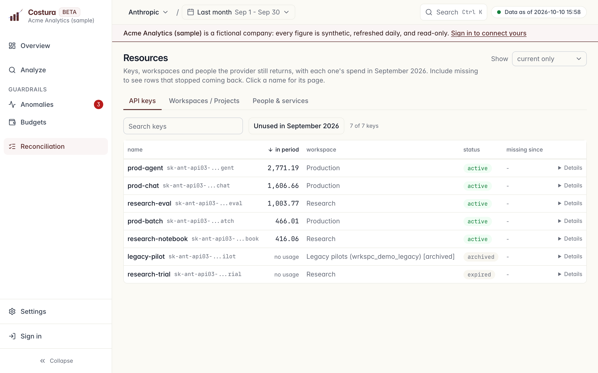

Resources (`/inventory`) has no menu item: search offers it when nothing matches, and the
sample's settings link to it. Three tabs list API keys, workspaces or projects, and people
and services, each with its spend in the period, status and the date it stopped coming
back. "Unused in <month>" filters to keys without usage. A fourth tab, Posture, lists each
active key with a governance gap once, with its spend in the last 30 days and its owner. A
key page shows the same gaps in a Governance card, with the owner, the last use and the
limit, and a link to the provider's key list where the registry records one. An owner or a
member snoozes a gap there for 7, 30 or 90 days with an optional note; it leaves the queue,
the bell and the webhook until then, and the card lists it with a button that brings it
back.

## Settings

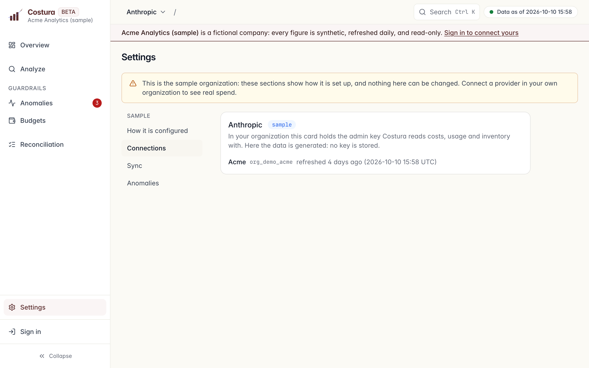

Connections holds one card per provider with its accounts, the key hint, the last
validation and the schedule; an owner connects, replaces or removes a key here. The other
sections are Organization, Sync, Anomalies, Members, Teams (owners map people, workspaces
and keys to a team), Audit (owners: who changed keys,
roles, members and settings, newest first), Advanced and Account. Anomalies also
holds the Slack webhook: an owner saves an incoming-webhook URL on a host the operator
allows (`COSTURA_WEBHOOK_HOSTS`), sends a test message, chooses a weekly or monthly digest
(the month so far, its projection and what needs a person), and reads the 20 newest
deliveries with their status, last error and attempt count. An owner resends one delivery
from its row; the message is rendered again from the signal as it stands, so a signal that
closed since is refused. Each new anomaly, budget alert and key gap is posted
once; the URL is never shown again, only its host. Account holds the alerts opt-in for the
bell, which lists unread anomalies, budget alerts and key gaps with a count per kind;
opening a budget alert or a gap from the bell marks it read. The sample explains how it is
configured and accepts no change.

A connector the registry marks `experimental` (GitHub Copilot) carries an
`experimental` badge on its Connections card and on the Welcome card, with one line saying
it has not run against a live organization yet. Settings > Sample (`/settings/sample`), shown
only on the sample organization, explains how the sample is configured and links to
Resources.

Before the shell, three pages take no view: `/sign-in` (Google when configured; a local
e-mail form only in development or test), `/new` (create an organization; its slug is the
immutable id) and `/join` or `/join/{token}` (accept an invitation; 403 when the signed-in
e-mail is not the invited one, 410 when it was revoked, used or expired). A new organization
then starts at Welcome: a picker of the providers without a key and one card for the chosen
provider, with where its key is created, what the key must read for spend, inventory and
key posture, and what it can do if it leaks ([provider keys](../security/provider-keys.md)).

## Keeping this page current

- `just web::screens` recaptures every image from `just dev`; commit the images with the
  change that altered a screen.
- The script that captures them is `apps/web/e2e/capture-screens.mjs`; a new screen is a
  new entry there and a new section here.
- The behavior stated here is the current code.
